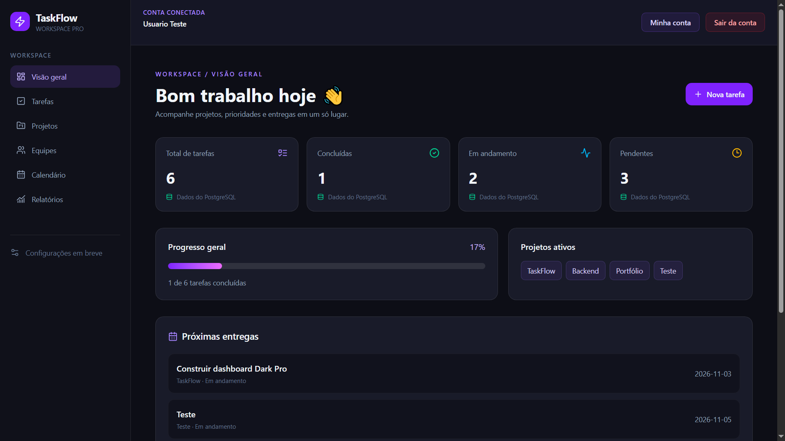
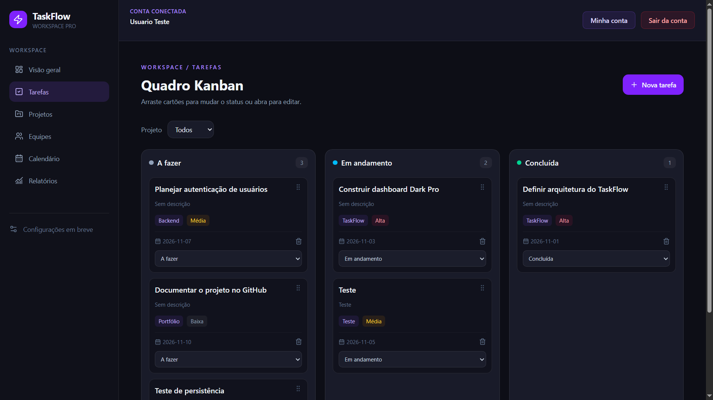
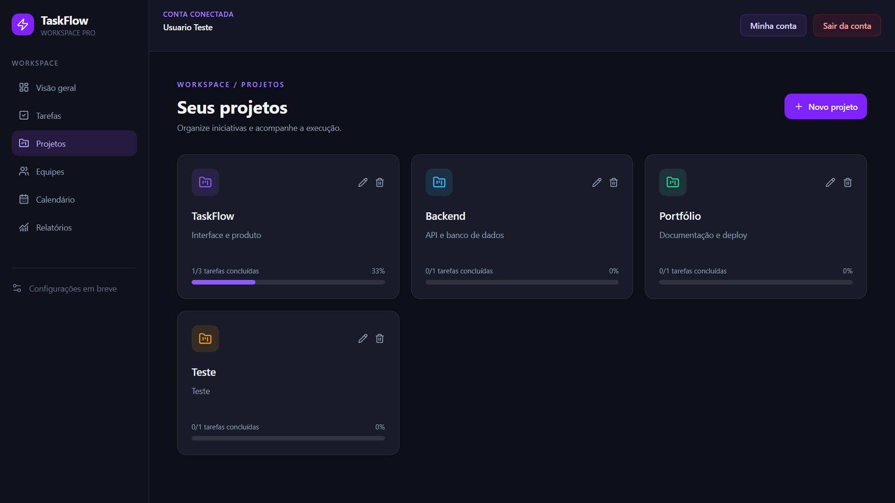
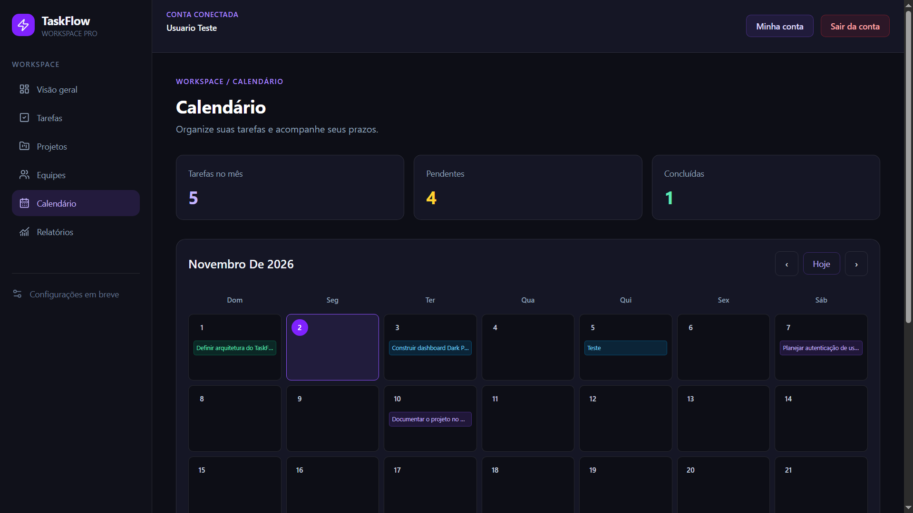
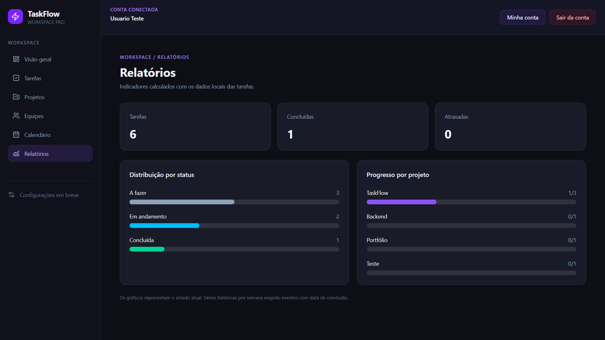
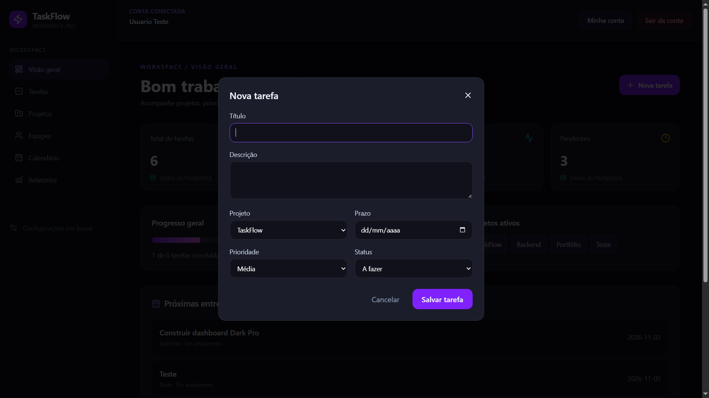

# TaskFlow Dark Pro v0.3

Atualização incremental sobre a v0.2.

## Novidades
- Detalhes de tarefa com checklist, comentários e atividade local.
- Kanban com destaque de coluna ao arrastar e cartões mais compactos.
- Relatórios por status e por projeto, com contagem de tarefas atrasadas.
- Dados de tarefas v0.2 preservados e migrados para `taskflow.tasks.v3` na primeira abertura.

## Instalação
Copie apenas a pasta `frontend/src` para a pasta correspondente do projeto existente. Preserve `backend`, `.git`, `package.json` e demais arquivos.

Na pasta `frontend` execute `npm.cmd run dev` (se as dependências já estiverem instaladas). Para validar, execute `npm.cmd run build`.

## Limitações
Comentários e histórico são locais e não têm autoria autenticada. Relatórios são instantâneos, não históricos. Anexos e backend ainda não foram implementados.

## 📸 Capturas de tela

### Dashboard

### Quadro Kanban

### Projetos

### Calendário

### Relatórios

### Criação de tarefas
